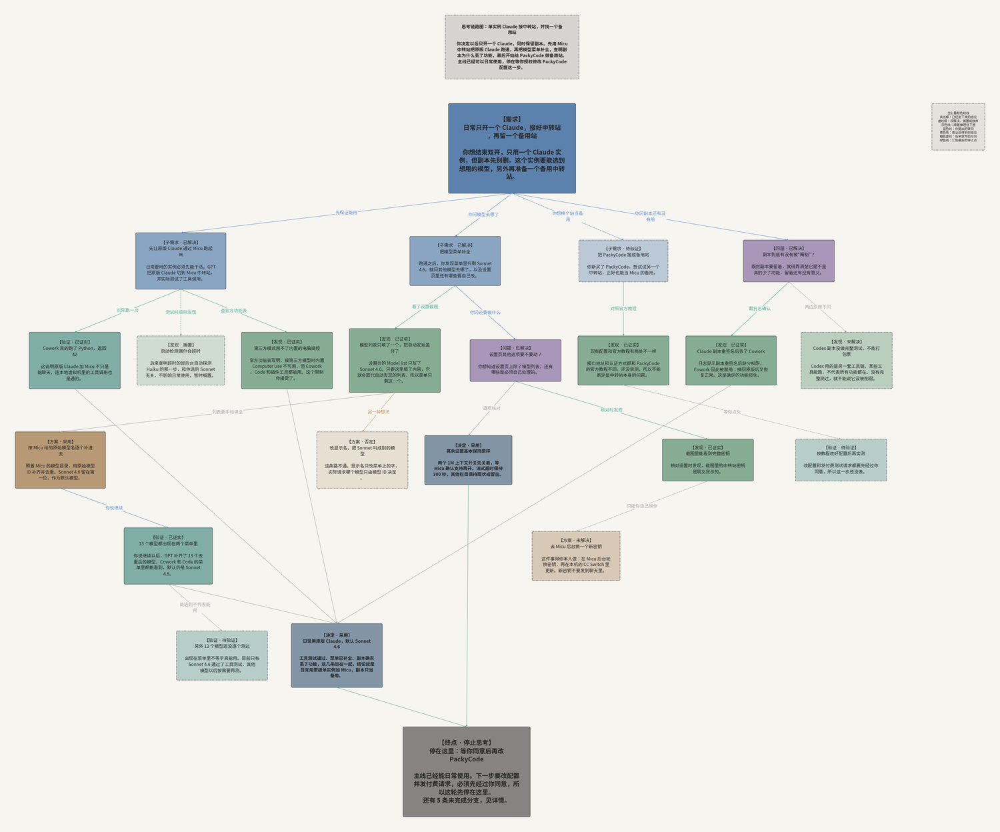
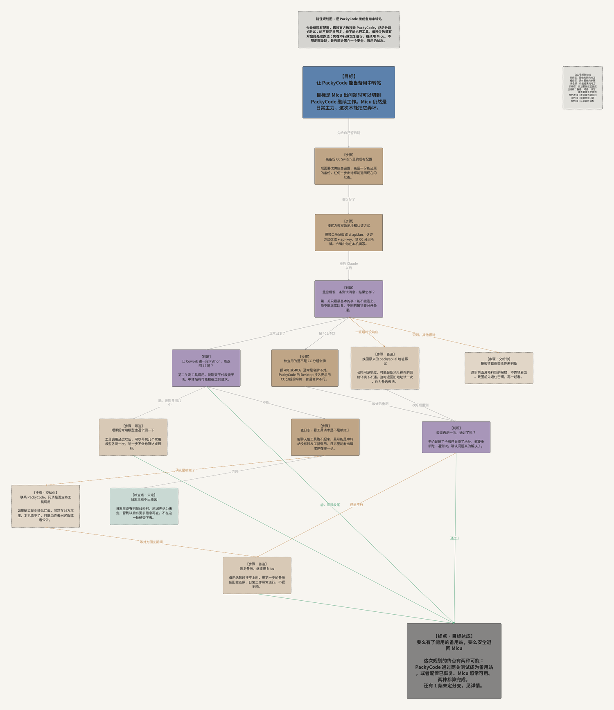

# project-graph-architect

> 和 AI 聊了两个小时，最后只记得结论，忘了是怎么想到这里的。
> Turn an AI conversation, or a plan you are about to run, into a Project Graph map you can actually re-read.

[](https://github.com/sigmaforcoding/project-graph-architect/stargazers)
[](https://github.com/sigmaforcoding/project-graph-architect/commits)
[](LICENSE)

**[中文](#中文) | [English](#english)**



---

<a name="中文"></a>
## 中文

这个 skill 让 AI 直接生成 [Project Graph](https://github.com/graphif/project-graph) 能打开的 `.prg` 图文件。它最擅长两件事：

**复盘。** 把你和 AI 的一段对话整理成一棵树：顶部是从你原话里提炼的需求，往下按“谁引出了谁”逐层分叉；被否定的方案、没解决的问题都留在图上；最底部是这轮思考停下来的地方，写清楚为什么停、还剩什么。几个月后再打开，不用翻聊天记录也能看懂。

**规划。** 动手之前先把路画出来：遇到会改变做法的情况就放一个判断点，每条线写清楚在什么条件下走；每条路都要走到目标、备选方案，或者一个明确的“停下来交给你”。

架构图、流程图、对比图等普通图也能画，走的是另一套排版规则。

### 你会得到什么

- 一个 `.prg` 文件，在 Project Graph 里直接打开、继续编辑。
- 每个节点有一句话标题和一到三句说明，读起来像人在讲事情，而不是笔记缩写。
- 节点详情里有你的原话、出处、理由和证据。终点详情汇总：已经定下来的、还没解决的、放弃了的方向、接下来做什么。
- 需要交给另一个 AI 时，可以出一份紧凑的 AI 版；AI 会根据你的说法自己判断出哪种，或者两种都出。
- 图文件里嵌着完整大纲，以后可以取回来接着往下画。



### 安装

```bash
npx skills add sigmaforcoding/project-graph-architect
```

然后装 Python 依赖（只需一次）：

```bash
python3 -m pip install -r requirements.txt   # 必需：msgpack
python3 -m pip install matplotlib==3.10.9   # 可选：生成 PNG 预览图
```

- [ ] Python 3.10 或更新版本（`python3 --version`）
- [ ] [Project Graph](https://github.com/graphif/project-graph) 桌面版，用来打开 `.prg`
- [ ] 一个支持 Agent Skills 的工具，例如 Claude Code、Codex CLI、Cursor

### 怎么用

直接对 AI 说：

- “把我们这段对话做成思考链路图，我想记住是怎么想到这里的。”
- “接 PackyCode 当备用站之前，先帮我画个路径规划：每种报错各怎么处理。”
- “把这次复盘做成图，我自己看完再交给 Codex 接手。”（会同时出给人读和给 AI 读的两份）

AI 会先给你看一棵文字树，确认结构没问题再生成图。

### 示例

`examples/` 里有三份真实大纲和生成好的图：

| 文件 | 用途 | 内容 |
|---|---|---|
| `thinking_chain_relay_setup` | 复盘 | 单实例 Claude 接中转站、补全模型菜单、查副本为什么丢功能 |
| `thinking_chain_skill_upgrade` | 复盘 | 这个 skill 自己是怎么一步步改出来的 |
| `path_plan_backup_relay` | 规划 | 把一个中转站接成备用站，每种失败怎么处理 |

### 常见问题

| 问题 | 解决办法 |
|---|---|
| `ModuleNotFoundError: No module named 'msgpack'` | `python3 -m pip install -r requirements.txt` |
| `human style needs a 'summary'` | 给人读的版本要求每个节点都有说明。补上 `summary`，或者用 `--style ai` 出紧凑版 |
| `no node has ≥2 children: this is a pipeline` | 大纲是按话题排成的直线，没有分叉。按“哪个问题引出了哪几个方案”重新组织 |
| 预览图中文显示成方块 | 装一个中文字体（Noto Sans CJK、PingFang、微软雅黑都行）。这只影响预览，不影响 `.prg` |
| `extract` 报 `no embedded outline found` | 这张图不是用 v1.2 之后的版本生成的，没有内嵌大纲 |

### 限制

- 排版和碰撞检查按 Project Graph 的默认字号估算，最终显示效果以软件里为准。
- 目标格式是 PRG 2.7.0，Project Graph 将来改格式时可能需要更新 `scripts/prg27.py`。
- 复盘图只记录对话里真实发生过的讨论，AI 不会补造没讨论过的方案；对话本身没说清楚的地方，图上也会标为“未解决”。

### 致谢

`.prg` 格式和渲染行为参考了 [graphif/project-graph](https://github.com/graphif/project-graph) 的公开源码。

### 许可与声明

本项目采用 GPL-3.0-only。它是非官方社区项目，与 Project Graph、Graphif 及其维护者不存在隶属、背书或赞助关系。详情见 `LICENSE` 与 `NOTICE.md`。

---

<a name="english"></a>
## English

This skill lets an AI agent write native [Project Graph](https://github.com/graphif/project-graph) `.prg` files. Its main job is **thinking-chain graphs**:

- **Review.** Turn a conversation with an AI into a tree. The root is your request, in your own words. Branches follow what led to what. Rejected options and open questions stay visible. One stop node at the bottom says why the thinking stopped and what is left.
- **Plan.** Map a task before doing it. Branch points carry conditions on their edges, and every path ends at the goal, a fallback, or an explicit hand-off.

General architecture, flow, and comparison graphs are supported as well, with a separate lane-based layout.

By default the text is written for people: a full-sentence title and a 1–3 sentence summary on every node, and prose details. The agent can also produce a compact AI-readable version (`--style ai`) or both (`--style both`) and decides which from how you phrase the request. Every `.prg` embeds its full outline JSON, so a later session can `extract` it and keep going.

### Install

```bash
npx skills add sigmaforcoding/project-graph-architect
python3 -m pip install -r requirements.txt   # required (msgpack)
python3 -m pip install matplotlib==3.10.9   # optional, PNG previews
```

### Try it

- "Turn this conversation into a thinking-chain graph so I remember how we got here."
- "Before I set up the backup relay, map the path: what to do for each kind of error."

### For developers

```bash
python -m unittest discover -s tests -v
python scripts/thinking_chain.py tree  examples/thinking_chain_relay_setup.json
python scripts/thinking_chain.py build examples/path_plan_backup_relay.json /tmp/plan.prg --style both
python scripts/thinking_chain.py extract /tmp/plan.prg /tmp/outline.json
```

Layout and collision checks estimate Project Graph's default font metrics; the app's own rendering is authoritative. Target format: PRG 2.7.0.

Licensed GPL-3.0-only. Unofficial community project, not affiliated with Project Graph, Graphif, or their maintainers. See `LICENSE` and `NOTICE.md`.

## 版本 / Changelog

- **v1.3.0**：AI 自动判断写法（给人读、给 AI 读、两种都出），新增 `--style both`；新增 `extract`，可以从已有的图取回大纲接着画；`SKILL.md` 描述改为 YAML 块格式，严格解析器也能读；新增 12 项回归测试。
- **v1.2.0**：思考链路图新增给人读的写法并设为默认，原写法保留为 `--style ai`；写作规范写进模式说明并由脚本检查；`.prg` 内嵌完整大纲。
- **v1.1.0**：新增思考链路模式（复盘、规划），分层树状排版，语义检查脚本，预览图。
- **v1.0.0**：初版：PRG 2.7 序列化、关系感知布局、主题安全配色、结构校验与碰撞审计。

## License

GPL-3.0-only. See `LICENSE` and `NOTICE.md`.
